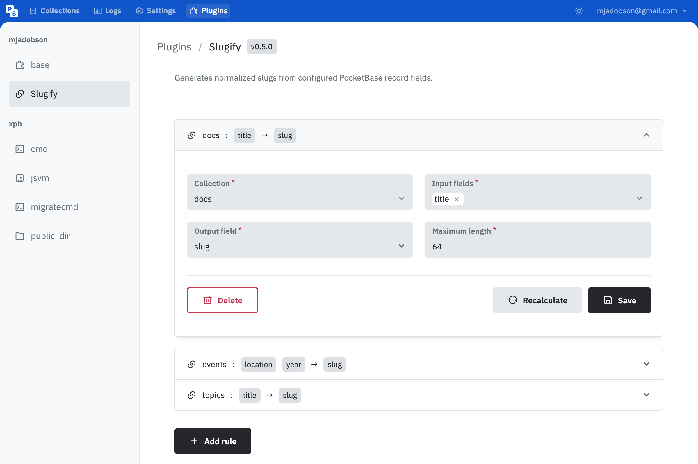

# Slugify

Generate PocketBase slugs from one or more record fields.



The plugin combines configured input fields in order, normalizes the text to lowercase alphanumeric segments separated by hyphens, truncates the result to the configured length, and adds numeric suffixes when needed to keep slugs unique.

## Installation

Slugify `v0.5.0` uses PocketBase `v0.42.3`, xpb `v0.1.0`, and Go `1.27.1+`. Custom Go applications must use the new `ganigeorgiev.com/pocketbase/*` imports.

Install the xpb CLI:

```sh
go install github.com/pocketbuilds/xpb/cmd/xpb@v0.1.0
```

Build PocketBase with the plugin:

```sh
xpb build v0.42.3 --with github.com/mjadobson/pb-plugin-slug@v0.5.0
```

## Setup

Install [pb-plugin-base](https://github.com/mjadobson/pb-plugin-base) in the same PocketBase build to expose the plugin's settings UI:

```sh
xpb build v0.42.3 \
    --with github.com/pocketbuilds/xpb@v0.1.0 \
    --with github.com/mjadobson/pb-plugin-base@v0.3.0 \
    --with github.com/mjadobson/pb-plugin-slug@v0.5.0
```

Open **Settings → Plugins → Slugify** and add one or more rules. Collections and fields are selected from the current schema. Each rule is stored as its own record in the system collection `_plugins_slug`, with `collection_name`, `input_fields`, `output_field`, `length`, `recalculating`, and `recalculation_error` fields.

Existing enabled `slugify` configuration in the legacy shared `_plugins` collection is imported automatically when `_plugins_slug` is empty.

Then make sure each target collection has:

- the fields listed in `input_fields`
- a text or editor field matching `output_field`
- a single-column `UNIQUE` index on `output_field` (recommended with `WHERE output_field != ''`)

The plugin runs after successful record create and update operations.
It reloads its active config whenever any row in `_plugins_slug` is created, updated, or deleted.
It also reloads when collections are created, updated, or deleted so deferred configs can become active after schema changes.
It does not backfill slugs for existing records unless you use the **Recalculate** button.

## Unique Index Requirement

`output_field` must have its own single-column unique index.

This plugin checks for existing slugs before saving, but concurrent writes can still race unless the database also enforces uniqueness. The unique index is what guarantees two records cannot end up with the same slug.

For SQLite-backed PocketBase collections, a good pattern is:

```sql
CREATE UNIQUE INDEX `idx_posts_slug_unique` ON `posts` (`slug`) WHERE `slug` != ''
```

Replace `posts` and `slug` with your collection and field names.

## Plugin Config

### `collection_name`

The PocketBase collection name to watch.

### `input_fields`

The fields to combine, in order, before generating the slug.

Use dotted paths such as `docs.name` to pull values from related collections.
Intermediate segments must be relation fields.

### `output_field`

The text or editor field where the slug should be written.

### `length`

The maximum slug length.

### `recalculating`

Managed by the plugin UI. Clicking **Recalculate** sets it to `true`, starts an asynchronous backfill in batches of 100, and resets it to `false` when finished. The UI listens to PocketBase realtime events and shows a spinner while the backfill is active.

### `recalculation_error`

Managed by the plugin. It is cleared when a recalculation starts and stores the failure message if the backfill cannot complete. The settings UI reports that failure in a toast when the realtime completion event arrives.

## Behaviour

- Input field values are joined with spaces in config order.
- Array-like input values are flattened and joined with spaces before slugging.
- Accents are removed where possible.
- Non-alphanumeric characters become hyphens.
- Repeated separators are collapsed and trimmed.
- Slugs are lowercased and truncated to `length`.
- If the slug already exists in the same collection, `-1`, `-2`, and so on are appended while staying within `length`.
- If all configured inputs are blank, the output slug is cleared.
- The output field must have its own unique index so concurrent writes cannot create duplicate slugs.
- Rules are validated when saved. Invalid pre-existing rules are skipped individually so valid rules can continue to run.

## Development

Build a PocketBase binary with this local plugin and the pinned pb-plugin-base release:

```sh
make build-pocketbase-binary
```

To test against a local pb-plugin-base checkout:

```sh
make build-pocketbase-binary BASE_PLUGIN="github.com/mjadobson/pb-plugin-base=$(cd ../pb-plugin-base && pwd)"
```

Run the checks:

```sh
go mod tidy
GOCACHE=/tmp/go-build go test ./...
GOCACHE=/tmp/go-build go test -race ./...
GOCACHE=/tmp/go-build go vet ./...
GOCACHE=/tmp/go-build go build ./...
node --check ui/main.js
```
